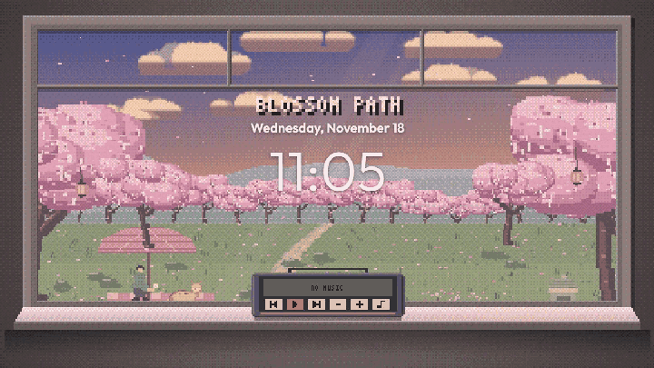
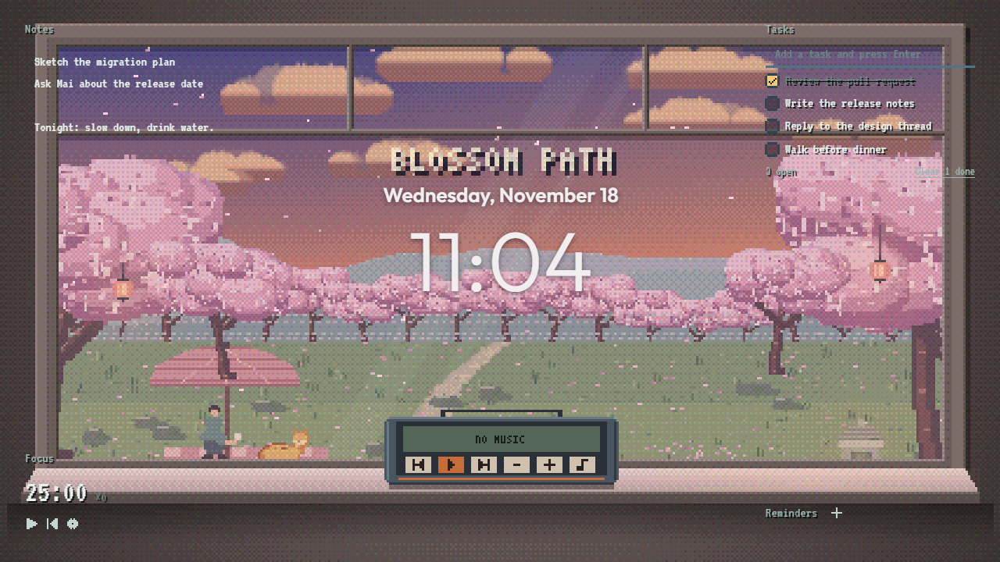
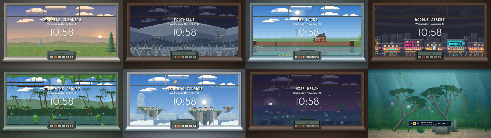
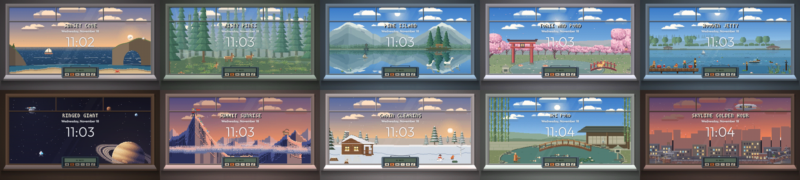
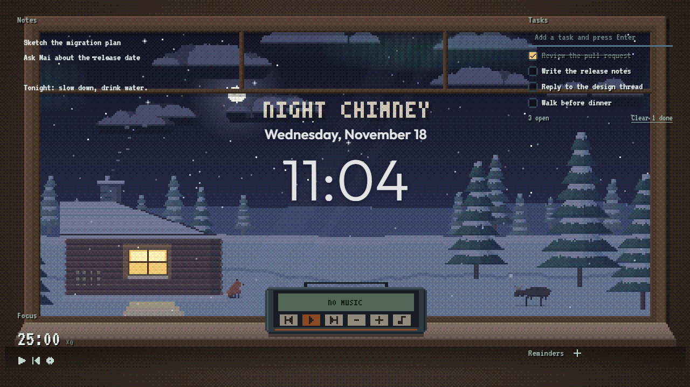
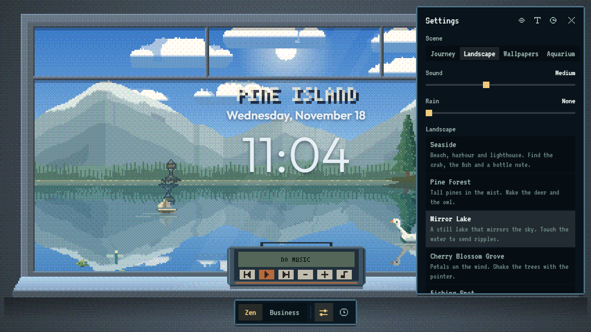

<p align="center">
  
</p>

<h1 align="center">ChillScreen</h1>

<p align="center">
  A calm, living pixel-art window for your second screen.<br>
  Journeys, landscapes and an aquarium, with notes, tasks, reminders, a focus timer and your YouTube music.
</p>

<p align="center">
  <a href="https://chillscreen.pages.dev"><strong>Open the live app</strong></a> ·
  <a href="docs/USAGE.md">Usage</a> ·
  <a href="docs/DEPLOYMENT.md">Deployment</a> ·
  <a href="docs/STORY.md">Story</a>
</p>

<p align="center">
  <a href="https://github.com/HyperionV/chill-screen/actions/workflows/ci.yml"></a>
  <a href="LICENSE"></a>
  
</p>

<p align="center">
  
</p>

## What it is

You sit in a room. In front of you there is a window, and through it there is somewhere calm to be: a night train crossing the snow, a canal at noon, a lantern-lit lake. The time sits in the middle of the glass, rain runs down it if you ask, and a little radio on the sill plays your music.

It is made for a second monitor or a spare tab while you work. It stays out of your way, runs lightly, and remembers everything.

<p align="center">
  
</p>

## Highlights

- **Seven journeys.** Long trips in chapters, each with its own cast and things to do: Wildwood Road, Night Train, Canal Barge, Rainy Night Bus, Jungle River, Sky Voyage, Fairy Road.
- **Ten landscapes.** Places that stay put but are deep and alive, each with several scenes to drift through: Seaside, Pine Forest, Mirror Lake, Cherry Blossom Grove, Fishing Spot, Interstellar, Alpine Peak, Snowy Cabin, Zen Garden, Rooftop City.
- **An aquarium** of fish, snails and shrimp that live their own lives, and **your own wallpapers** as a slideshow.
- **Real time of day.** The sky, light and colours follow the clock. A day/night control (like Minecraft's) lets you pause, speed up or jump to any hour.
- **Wind and weather.** Leaves, grass, flags and smoke sway on one shared breeze, clouds drift and change shape, rain collects on the glass and you can wipe it with the mouse.
- **Zen and Business modes.** Zen shows only the scene. Business adds notes, tasks, reminders and a pomodoro focus timer, floating over the picture.
- **Music on the window sill.** Paste a YouTube playlist link, or sign in with Google (read-only) for your own playlists, liked videos and search.
- **Local and private.** Everything you write stays in your browser. No account, no tracking.
- **Installable.** A web app with a manifest: install it for its own window.

## Take a look

### Journeys

<p align="center"></p>

### Landscapes

<p align="center"></p>

### Modes and settings

<p align="center">
  
  
</p>

More pictures are in [`docs/assets/scenes`](docs/assets/scenes).

## Quick start

You need Node 22.

```bash
git clone https://github.com/HyperionV/chill-screen.git
cd chill-screen
npm install
npm run dev          # http://localhost:4173
```

Pasting a YouTube playlist link works straight away. To browse your own playlists, set up Google sign-in as described in [docs/DEPLOYMENT.md](docs/DEPLOYMENT.md). For a deployed copy of your own (Cloudflare Pages is free and takes a few minutes), follow the same guide. How to use the app is in [docs/USAGE.md](docs/USAGE.md).

You can open a scene directly from the address bar: `?journey=night-train`, `?landscape=cherry-grove`, `?hour=21`, `?chapter=2.5`.

## How it is built

- **TypeScript and Vite**, strict mode, with no UI framework. Two runtime dependencies, both fonts ([Outfit](https://fonts.google.com/specimen/Outfit) and [VT323](https://fonts.google.com/specimen/VT323), SIL Open Font License).
- **Every scene is drawn in code** on a small Canvas 2D stage (about 480 by 270 pixels) that is scaled up. There are no image files and no audio files: the ambient sound is made with Web Audio.
- **Depth and life.** Scenes are layers of sprites built once into offscreen canvases, with a small cast whose members have their own behaviour (idle, wander, notice you, flee). Time of day comes from one shared sky; wind comes from one shared breeze (`src/room/wind.ts`).
- **Light on the machine.** About 30 frames a second with an 8 ms frame budget, only one scene running at a time.
- **One small serverless function** (Cloudflare Pages Function, `functions/`) keeps Google sign-in alive for months. It is optional; without it everything else works.

```
src/
  room/journeys/     seven journeys, one folder each
  room/landscapes/   ten landscapes, one folder each
  room/              window, sky, clouds, wind, rain, clock, radio
  world/             the aquarium
  ui/                toolbar, settings, notes, tasks, reminders, timer, music
  music/             YouTube player, playlists, Google sign-in
functions/           the optional sign-in function
tests/               unit tests
docs/                usage, deployment, story, images
```

## Contributing

Scenes, fixes and ideas are welcome. Read [CONTRIBUTING.md](CONTRIBUTING.md) first: the project has a strong taste (calm, slight motion, pixel art drawn in code), and it is easier to get a scene merged when it follows it.

```bash
npm run check && npm test && npm run build
```

## Credits and notes

- Fonts: Outfit and VT323, SIL Open Font License 1.1.
- Music plays through YouTube's own player and is subject to YouTube's terms. ChillScreen is not affiliated with or endorsed by YouTube or Google.
- Made by [HyperionV](https://github.com/HyperionV), planned and built with Claude Code and Codex. The story is in [docs/STORY.md](docs/STORY.md).

## License

[MIT](LICENSE)
